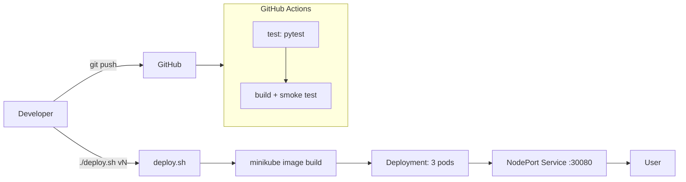

# ShipFast: An Automated CI/CD Pipeline for Containerized Web Apps with Zero-Downtime Deployment on Kubernetes

## Problem Statement
Manual releases are slow and error-prone: untested code gets shipped, "works on my machine" bugs appear, and updating a running app causes downtime. ShipFast automates testing, packaging and rolling deployment of a small Flask app ("Campus Notice Board") so a release is one command and users never see an outage.

## Objectives
- Package the app reproducibly with Docker.
- Run tests and a container smoke test automatically on every push (GitHub Actions).
- Deploy to Kubernetes with 3 replicas, health probes and rolling updates (`maxUnavailable: 0`).
- Automate the whole release with one Bash script and prove zero downtime with a live loop.

## Mapping to Course Units
| Area | Unit | Files |
|---|---|---|
| Docker | Unit 1 | `Dockerfile`, `.dockerignore` |
| GitHub Actions CI | Unit 4 | `.github/workflows/ci.yml`, `tests/test_app.py` |
| Bash automation | Unit 6 | `deploy.sh`, `demo-loop.sh`, `demo-loop.ps1` |
| Kubernetes | Unit 7 | `k8s/deployment.yaml`, `k8s/service.yaml` |

## Architecture


## Tech Stack
Python 3.11 + Flask, pytest, Docker, GitHub Actions, Kubernetes (Minikube), Bash.

## Setup & Run
Prerequisites: Docker Desktop, Minikube, kubectl, Git, Python 3.11.

```bash
pip install -r app/requirements.txt
pytest -v                                   # run tests

docker build -t shipfast:v1 .               # run in Docker
docker run -d -p 5000:5000 --name shipfast-test shipfast:v1

minikube start --driver=docker              # run on Kubernetes
./deploy.sh v1
minikube service shipfast-service --url    # keep terminal open on Windows
./deploy.sh v2                              # zero-downtime update
```
Full presentation steps: see [DEMO.md](DEMO.md).

## Results
- Tests and Docker smoke test run automatically on every push; a failing test blocks the build job.
- `deploy.sh v2` updated 3 running pods with the demo loop showing `v1 -> v2` and no `FAILED` lines.
- Deleting a pod or scaling to 5 replicas is handled by Kubernetes automatically; `kubectl rollout undo` restores the previous version.

## Conclusion
ShipFast shows a complete small-scale CI/CD flow: code is tested, containerised, deployed and updated with no downtime, using only Docker, GitHub Actions, Kubernetes and Bash.

## Future Scope
- Push images to a registry (Docker Hub / GHCR) and deploy from CI automatically.
- Add an Ingress, autoscaling (HPA) and resource monitoring.
- Add linting and security scanning of the image in CI.
